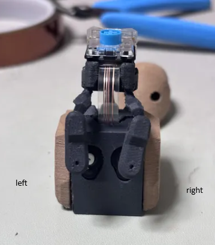

# Webcam motion follower: RoBoHoN elbow servos

This variant of [`webCamMotion`](../webCamMotion/) drives BEN's neck with two
RoBoHoN (Sharp SR01M) bus servos taken from the elbows, instead of the
DM-S0020 PWM micro servos.

The laptop side is unchanged. Run `webcam_bridge.py` from `../webCamMotion`
exactly as described there. The bridge still sends BEN's servo angles
(servo 1: 90-135, servo 2: 50-90, home 90), and this firmware converts each
angle into a RoBoHoN raw position and sends Sharp head/elbow-bus frames
instead of 50 Hz PWM.



## Servo assignment (viewed from the back of the robot)

| Side  | RoBoHoN servo | Head-bus SID | Bridge servo | Home (raw) |
|-------|---------------|--------------|--------------|------------|
| Left  | LEFT_ELBOW    | 4            | servo 1      | 1565       |
| Right | RIGHT_ELBOW   | 5            | servo 2      | -1256      |

The same frame is sent on **GPIO 4 and GPIO 5**. Each servo only obeys its
own SID, so either data wire can go to either servo pad. What matters is
that the left elbow servo is physically on the left and the right elbow
servo is physically on the right.

## Bus protocol

115200 baud, 8N1, TX only, idle high. Each 30-byte frame is:

```text
77 80 00 03 06 00 | [pos_lo pos_hi flag sid] x 5 | trailer lo hi flag | checksum
```

- `flag` is `0x40` to move or hold and `0xFF` to relax.
- `checksum = (256 - sum(bytes 6..28)) & 0xFF`.
- At home, the frame matches a stock RoBoHoN head-bus capture:
  `77 80 00 03 06 00 EF 00 40 01 1E F6 40 02 DE 08 40 03 1D 06 40 04 18 FB 40 05 6D 00 40 E5`

## Wiring

| Servo wire | Connect to |
|------------|------------|
| Data       | GPIO 4 or GPIO 5 |
| Negative   | GND, common with the ESP32-C3 |
| Positive   | 1S Li-ion/LiPo (3.7 V nominal) |

Power: RoBoHoN runs these servos from a single-cell pack. BEN's servo power
pad is USB 5 V, which is above a fully charged cell, so power the servos
from a 1S cell with its negative tied to BEN's GND.

## Build and flash

```bash
cd firmware/examples/webCamMotionRobohon
source /path/to/esp-idf/export.sh
idf.py set-target esp32c3
idf.py build
idf.py -p /dev/ttyACM0 flash
```

On Windows, use the ESP-IDF PowerShell and the board's COM port instead of
`/dev/ttyACM0`. ESP-IDF 5.3 or newer is required.

## Fitting the arms (home)

Run the bridge with `--home-only` (from `../webCamMotion`). Both actuators hold
home (left raw 1565, right raw -1256) until you press Ctrl+C. Fit both arms
vertical while they hold.

If your build still has the head button, pressing it while the bridge is
**not** running also toggles the home hold (the heart LED lights while held).

There is no Serial Monitor test mode: the USB serial port is used by the
bridge. Close any Serial Monitor before running the bridge.

## Run

```bash
cd firmware/examples/webCamMotion
python webcam_bridge.py --port /dev/ttyACM0
```

While the bridge is connected, the head button sends Space as before.

## First test and calibration

Do this with the arms or links unhooked.

1. Run the bridge and look straight at the camera. Both arms should rotate
   about 20 degrees **outward**, away from each other.
2. If an arm rotates inward, flip that side's sign in `main/main.c`
   (`LEFT_DIR` or `RIGHT_DIR`), then rebuild and flash.
3. Scale: `COUNTS_PER_DEG` is 182.04 (65536 / 360). If the arms rotate more
   or less than the change in servo angle shown in the bridge window,
   measure one arm and correct `COUNTS_PER_DEG`, or adjust
   `--servo-pitch-travel` and `--servo-roll-travel` on the bridge.

## Safety

- The firmware clamps each servo to a window around home (left -1000 to
  +9200 counts, right -8300 to +1000 counts), on top of the bridge's angle
  limits.
- If the bridge stops sending for 1 second, or stops tracking a face, both
  servos are sent relax frames.
- Do not flash `internalTest` with these servos fitted. It outputs PWM,
  which the RoBoHoN servos do not understand.
