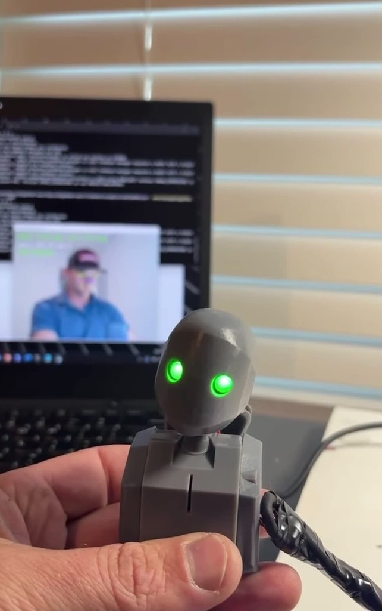
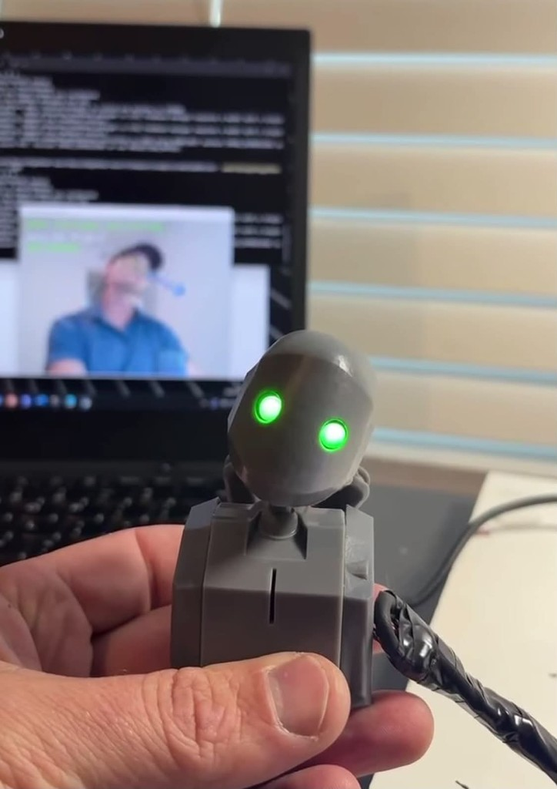
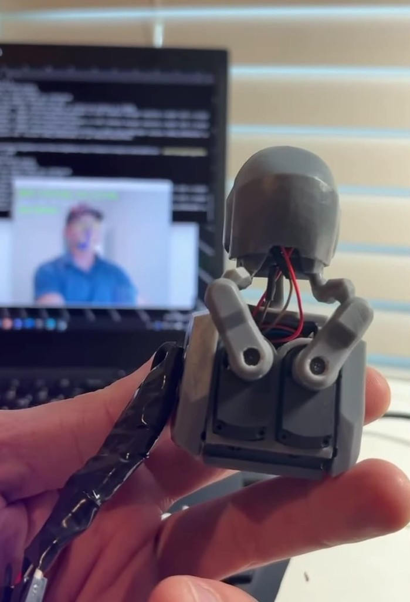

# RoBoHoN variant: printed parts

Parts changed for the RoBoHoN-actuator build. Everything else prints
from the standard design in [`../Design/BEN_assembled.step`](../Design/BEN_assembled.step).

| File | What changed |
|---|---|
| `neck.stl` | Two slots for 5 mm through-hole LEDs (replaces the FPCB eye LEDs). The Kailh Choc switch mount is removed, so the head clips straight onto the neck. |
| `left_bracket_90pct_sphere.stl` | Left neck bracket. The ball on the neck side is scaled to 90% of the original. |
| `right_bracket_90pct_sphere.stl` | Right neck bracket. Same 90% ball on the neck side. |
| `5mmLED_v2.stl` | 5 mm LED part for the eyes. |
| `servo-sides-back-view.png` | Reference photo: left and right sides, viewed from the back of the robot. |

## Why the 90% ball

With the full-size ball, the bracket-to-neck joint was too tight: too much
friction, and brackets snapped while rotating. These parts were printed in
resin, which likely holds tighter tolerances than FDM/PLA. If you print in PLA
and the full-size joint moves freely, you may not need the 90% version.

`neck.stl` is about 52 MB, high-poly but printable. Decimate it in your slicer
or Blender if your tools struggle with it.
